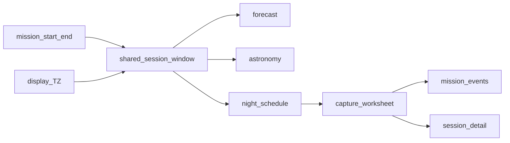

# Time-Aware Planning + Capture Worksheet

**Status:** Implemented (local verification; hosted migrations not claimed)  
**Preserve:** Auth/RLS, locations/gear, night schedule acceptance model, observing log (`mission_events` / `condition_logs`), Save Log → Sessions, Demo labels for unwired AI/telemetry, all uncommitted work.

**Classification:** Architectural — two sequential, shippable slices. Slice 1 unlocks correct forecast/astro/schedule windows; Slice 2 builds on persisted targets + timeline.

---

## Intent

Ship two sequential slices so mission planning uses one honest observing window (start/end, TZ, no silent mutation), then an equipment-aware capture worksheet that separates proposed settings from actuals and never silently shortens schedules.

**Locked assumptions:**
- Persist real `session_end_at` (migration `20261006120000_mission_session_end_location_tz.sql`).
- Optional site IANA timezone on locations (no lat/lon→TZ inference).
- Default start: practical upcoming 21:00; default end = start + 6h.
- After useful night / late night: next evening 21:00.
- Capture worksheet stores `proposed_*` separately; warn-only fit math; no invented optimal exposure.

---

## Current state (audit)

### Already present (do not re-invent)

| Piece | Path |
|-------|------|
| Session window helper | `src/lib/time/sessionWindow.ts` |
| Verify script | `scripts/verify-session-window.ts` (`npm run test:session-window`) |
| Migration | `supabase/migrations/20261006120000_mission_session_end_location_tz.sql` |
| Zod/types/queries for `session_end_at` + `locations.timezone` | schemas, `persistMission`, `mapMissionFromDb` |
| Observing log / actuals | prior migrations + `ObservingTimeline` |

### Slice 1 gaps (pre-wiring)

- Create Mission: today 21:00 even after 21:00; silent +24h when end ≤ start; does not persist `sessionEndAt`.
- Consumers use `sessionIntervalFromDateTime` → +6h when end omitted.
- ContextChipsBar: calendar-day “Tonight”, no observing-night / TZ abbr.
- No past-start warning UI; no schedule-conflict review gate; Locations UI has no timezone field.

### Slice 2 gaps

- No `proposed_*` columns, no `CaptureWorksheet`, no `capture_plan_updated` event kind.
- `sub_length` / `frames` / `planned_iso_gain` conflate planned vs actual; Save Log writes `iso` only.
- Mock ExposurePlannerCard unlabeled as Demo; no missing-evidence list.

---

## Slice 1 — Time-aware mission planning

### User flow

1. **Create Mission** opens with `defaultUpcomingSession(now, siteTimezone)` — start and end datetime-locals showing full dates.
2. User edits start/end freely. If end ≤ start → blocking error; **no +24h roll**.
3. If start is in the past → banner: **Use current time** / **Keep time to log an earlier session**.
4. Forecast, astronomy, recommendations, and scheduler all use `sessionWindowFromMission` (one interval).
5. Labels: “Tonight” via `formatObservingNightLabel` + date span + TZ abbreviation.
6. Optional **site timezone** on Location; null = device TZ. Window change invalidating schedule → conflict UI, require review.
7. Past window vs outage: ended → “Session ended”; provider error → “Unavailable”; future no-overlap → “Out of range”.

### Locked defaults

| Now (site or device local) | Default start | Default end |
|----------------------------|---------------|-------------|
| Hour 12–20 inclusive | Today 21:00 | Start + 6h |
| Hour ≥ 21 | Next calendar day 21:00 | Start + 6h |
| Hour 0–11 | Next calendar day 21:00 | Start + 6h |

### Site timezone (smallest dependable)

- Column: `locations.timezone text null` (IANA).
- UI: optional select — curated common IANA list + “Device time (default)” null.
- Pass `location.timezone` into sessionWindow helpers.
- **Out of phase:** lat/lon→TZ inference.

### Files

- Adjust: `src/lib/time/sessionWindow.ts`, `scripts/verify-session-window.ts`
- Wire: Create Mission, ContextChipsBar, mapper, MissionConditionsPanel, dashboard sky, explorer, NightScheduleReview, LocationsSection, formatWindowLabel consumers

### Acceptance

**Automated:** `npm run test:session-window`; `test:schedule`; `typecheck`; `lint`.

**Manual:** Create at 11 PM / 3 PM / 6 AM; past Keep vs Use current; end before start blocked; site TZ; schedule conflict → Review; forecast/astro same window; ended ≠ Unavailable.

---

## Slice 2 — Equipment-aware capture worksheet

### User flow

1. Planning: per target filter, ISO and/or gain, proposed sub (s), desired integration (min). Derived frames; estimated time = integration + transitions + 10 min setup.
2. Fit check vs schedule: **warn only** — never shorten or rewrite schedule.
3. Capture shows worksheet as editable proposed; actuals separate.
4. Logging seeds ISO/gain/sub/filter from proposed; **actual frames blank until recorded**.
5. Proposed changes → `capture_plan_updated` (corrections via `correction`).
6. Save Log snapshots planned onto `session_targets`; writes iso **and** gain; Session shows Planned vs Actual.
7. Exposure recommendations: list missing evidence; Demo-label mocks; never “optimal exposure”.

### Schema

- `mission_targets`: `proposed_filter`, `proposed_sub_length_seconds`, `proposed_iso`, `proposed_gain`, `proposed_integration_minutes`
- `session_targets`: planned snapshot columns + `planned_frames`
- `mission_events.kind`: add `capture_plan_updated`
- Keep `sub_length` / `frames` / `planned_iso_gain` as actual/legacy; one-time copy recipe → `proposed_*`

### Fit math

`src/lib/capture/worksheetMath.ts` + `npm run test:capture-worksheet`.

### Acceptance

**Automated:** worksheet math; mission event kind; typecheck/lint.

**Manual:** Planning → Capture → Logging → Session dual columns; fit warn; timeline; Demo/evidence.

---

## Global constraints

- Preserve uncommitted work; focused diffs only.
- Supabase Auth/RLS unchanged.
- Demo/mock labels for unwired AI/telemetry.
- Local: `supabase migration up --local`. Hosted: apply session_end/tz then capture-plan before claiming prod durability.
- Report which checks ran.

## Out of phase

Lat/lon→TZ, historical weather, auto-reschedule, optimal-exposure model, gear filter-wheel profile table, offline queue, Electron.
